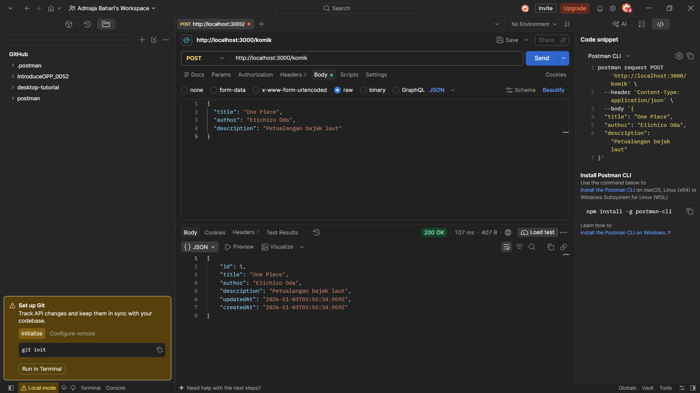
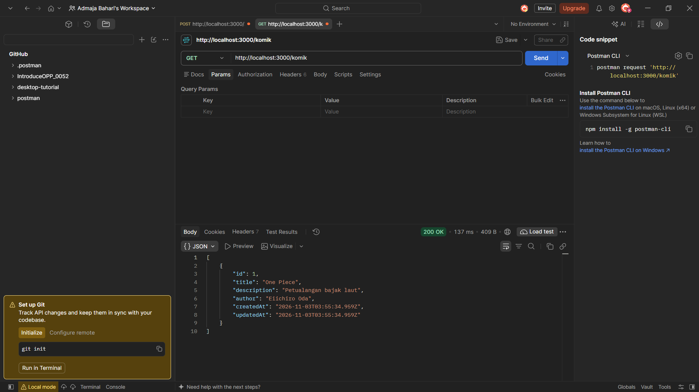
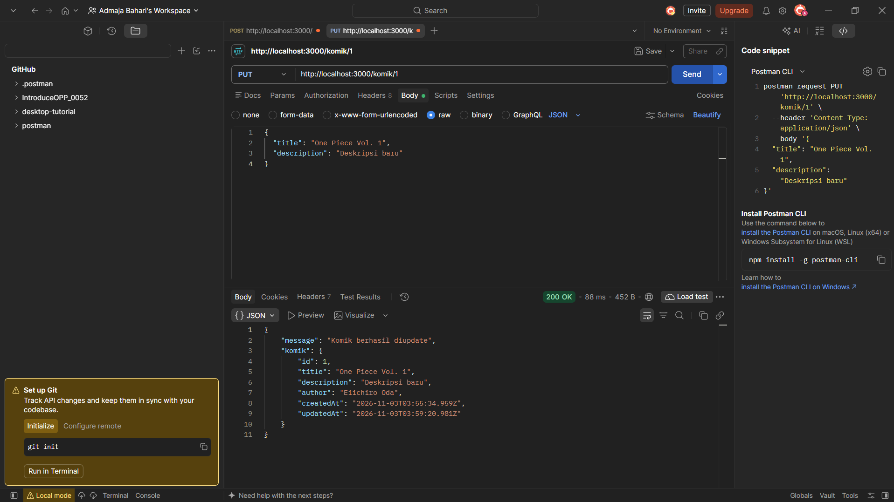
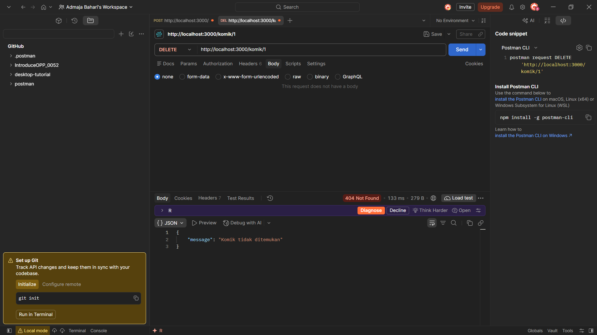

# 052_EnvORM

REST API CRUD data komik menggunakan Express.js, Sequelize ORM, dan PostgreSQL. Konfigurasi database disimpan di file `.env`.

## Teknologi

- Node.js dan Express.js
- Sequelize dan Sequelize CLI
- PostgreSQL (database `perpustakaan`)
- dotenv dan nodemon

## Cara Menjalankan

1. Clone repository dan install dependensi:
   ```bash
   git clone https://github.com/AdmajaBahari/052_EnvORM.git
   cd 052_EnvORM
   npm install
   ```
2. Buat file `.env` di root project:
   ```dotenv
   DB_USER=postgres
   DB_PASS=password_postgres_kamu
   DB_DATABASE=perpustakaan
   DB_HOST=localhost
   DB_PORT=5432
   DB_DIALECT=postgres
   PORT=3000
   ```
3. Buat database `perpustakaan` di pgAdmin.
4. Jalankan server (tabel `Komiks` dibuat otomatis oleh Sequelize):
   ```bash
   npm start
   ```

## Endpoint

| Method | URL | Keterangan |
|--------|-----|------------|
| POST | `/komik` | Menambah komik |
| GET | `/komik` | Menampilkan semua komik |
| PUT | `/komik/:id` | Mengubah komik berdasarkan id |
| DELETE | `/komik/:id` | Menghapus komik berdasarkan id |

## Hasil Pengujian (Postman)

### POST
Body request (JSON): `title`, `author`, `description`.



### GET


### PUT


### DELETE
